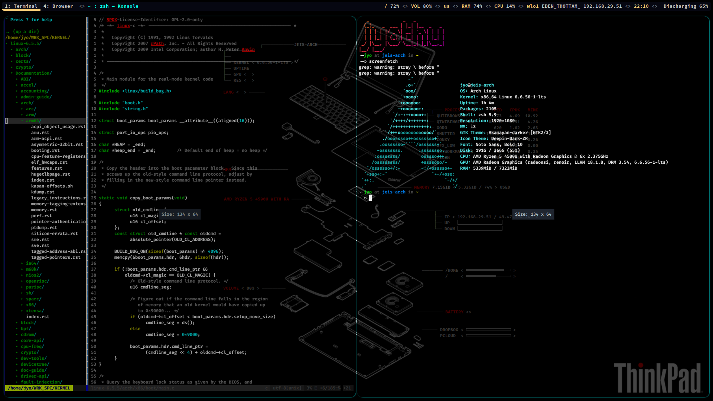
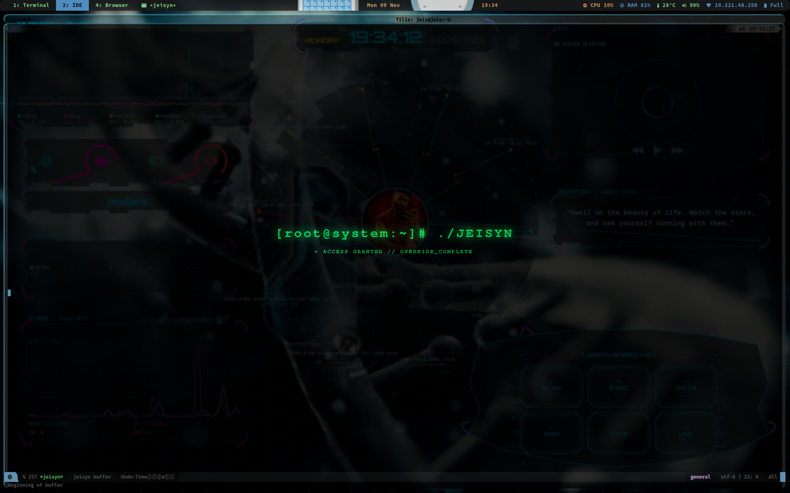

# Arun Jyothish

### Software Design Engineer | Embedded Linux | RTOS | Systems Programming | Networking & Multimedia

Software Design Engineer focused on embedded Linux, real-time operating systems, systems programming, multimedia frameworks, networking, and edge computing. Interested in developing efficient software solutions spanning kernel-level development, hardware integration, real-time communication, and intelligent edge applications.

---

## Technical Skills

| Category               | Technologies                                                               |
| ---------------------- | -------------------------------------------------------------------------- |
| Programming Languages  | C, C++, Python, Bash                                                       |
| Operating Systems      | Linux, Embedded Linux, Arch Linux, FreeRTOS                                |
| Embedded Platforms     | ARM, NXP i.MX8M Plus, NVIDIA Jetson, ESP32                                 |
| Linux Development      | Yocto, PetaLinux, Linux Kernel, Device Tree                                |
| RTOS & Firmware        | FreeRTOS, Task Management, Queues, Semaphores, Mutexes, Interrupt Handling |
| Multimedia & Drivers   | V4L2, Thermal Camera Integration, FFmpeg, GStreamer, Live555               |
| Networking & Protocols | TCP/IP, UDP, MQTT, HTTP, RTSP, WebRTC, mDNS                                |
| Cloud & Infrastructure | Docker, Linux Server Administration                                        |
| Version Control        | Git, Gerrit                                                                |
| Project Management     | Redmine                                                                    |

## Selected Engineering Projects

- **Custom Embedded Linux:** Yocto-based Linux distribution development, BSP customization, kernel configuration, and Device Tree integration.
- **Linux Video & Thermal Camera Integration:** V4L2 video capture, thermal camera integration, sensor data acquisition, and multimedia pipelines.
- **ESP32 Thermal Monitoring System:** SPI-based thermal sensor integration, FreeRTOS-based firmware architecture, task management, and wireless monitoring.
- **RTOS-Based Firmware Development:** Real-time task scheduling, inter-task communication, synchronization, and peripheral integration using FreeRTOS.
- **Networked Multimedia Applications:** RTSP streaming, FFmpeg, GStreamer, WebRTC, and MQTT-based communication.

## Custom Linux Development Environment

A personalized, keyboard-driven Arch Linux environment optimized for software engineering and productivity.

- **OS:** Arch Linux
- **Window Manager:** i3wm
- **Editor:** Emacs / Spacemacs
- **Productivity:** Org-mode, Org-roam
- **Development:** Git, Gerrit, Docker, Yocto, PetaLinux
- **Shell:** Bash

Customized workflows, editor configurations, window management, and development tools tailored for embedded systems and C/C++ development.



*Tiled i3 workspace on Arch Linux. Emacs holds the kernel tree (`boot/main.c`); the pane beside it is a live readout of the machine — kernel 6.6 LTS, zsh, i3, and a Ryzen 5 with Radeon graphics.*


*The environment in motion: kernel C in Emacs, a GCC kernel build, a Git push, and an FFmpeg screen encode, each in its own tile.*

## Portfolio & Independent Projects

- **Personal Portfolio:** [arunjyothishk.me](https://arunjyothishk.me) — Professional portfolio showcasing my technical background and engineering projects.
- **Jeisyn:** [jeisyn.in](https://jeisyn.in) — Independent technology initiative focused on software products and engineering solutions.



*JEISYN's Emacs splash (`*jeisyn*`): a custom dashboard buffer on the i3 desktop, opening on the JEISYN board — scan, sync, data, RAM, core, and log.*

## Collaboration

Interested in open-source collaboration involving:

- Embedded Linux and kernel development.
- Linux device drivers and multimedia frameworks.
- C/C++ systems programming and FreeRTOS.
- Networking and real-time streaming.
- IoT and edge computing.

## Connect With Me

- **Email:** [arunjyothishk@gmail.com](mailto:arunjyothishk@gmail.com)
- **LinkedIn:** [LinkedIn Profile](https://www.linkedin.com/in/arun-jyothish/)
- **GitHub:** [GitHub Profile](https://github.com/arun-jyothish)
- **Stack Overflow:** [Arun Jyothish K](https://stackoverflow.com/users/28410734/arun-jyothish-k)

## Beyond Coding

I enjoy playing guitar, exploring emerging technologies, and continuous learning. I value curiosity, knowledge sharing, clean code, and collaborative engineering.

**Favorite Languages:** C and C++

---

### Engineering Philosophy

```C
struct Engineer {
    bool curious = true;
    bool collaborative = true;
    bool ego_driven = false;
};

int main() {
    Engineer engineer;

    // Keep learning.
    // Share knowledge.
    // Build meaningful things.

    return 0;
}
```

*Building systems, exploring technology, and learning continuously.*

